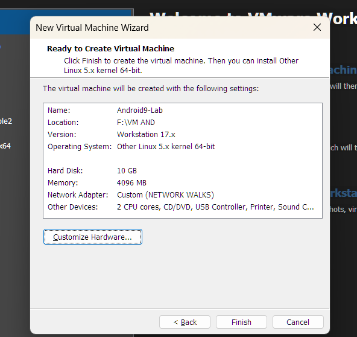
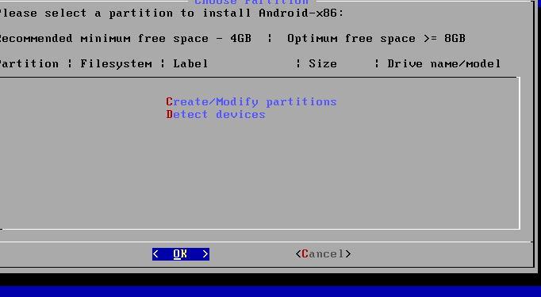
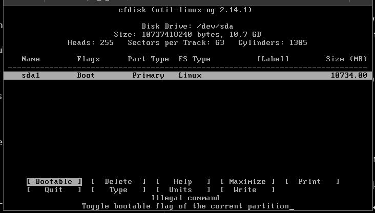
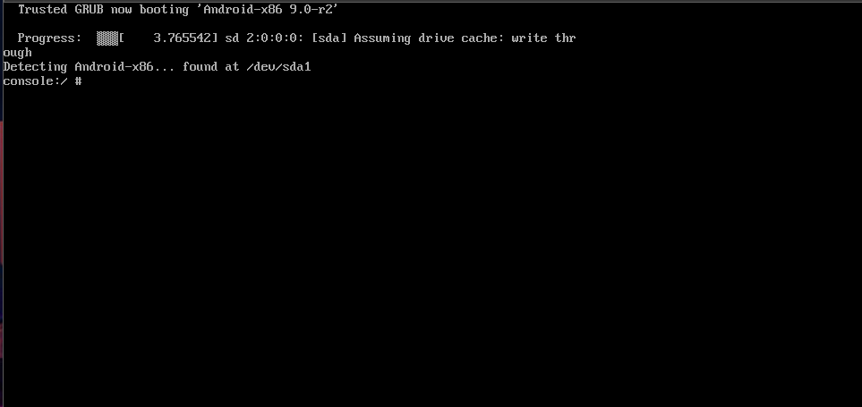
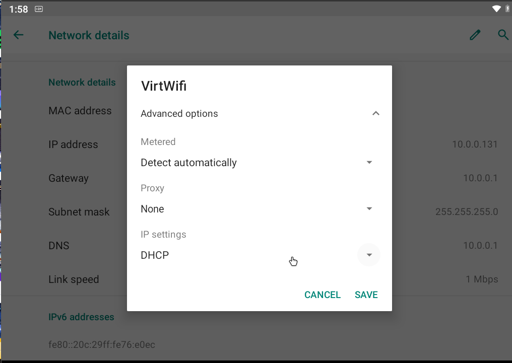
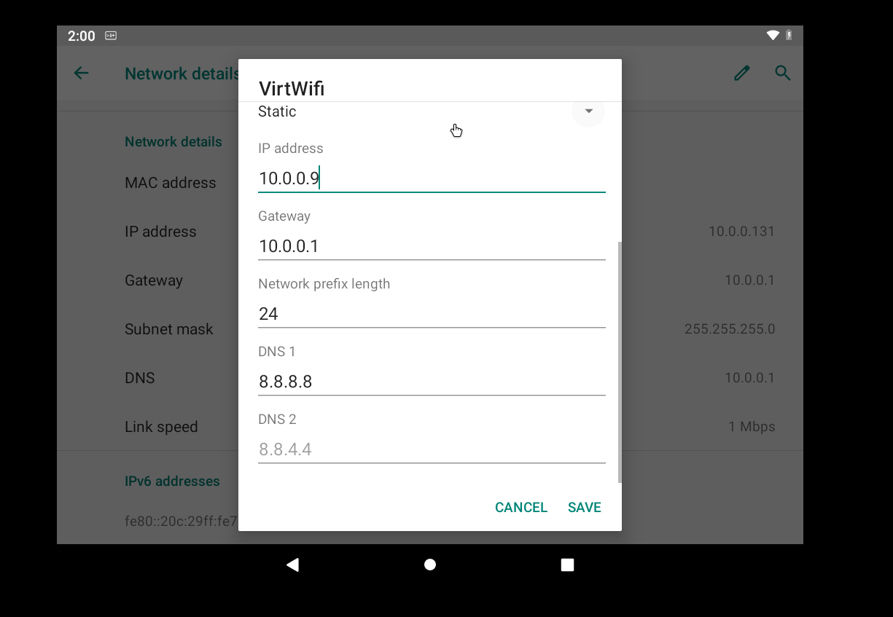
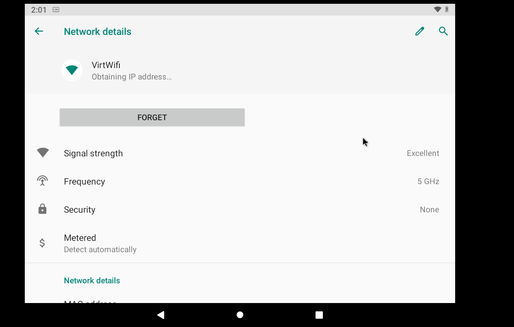
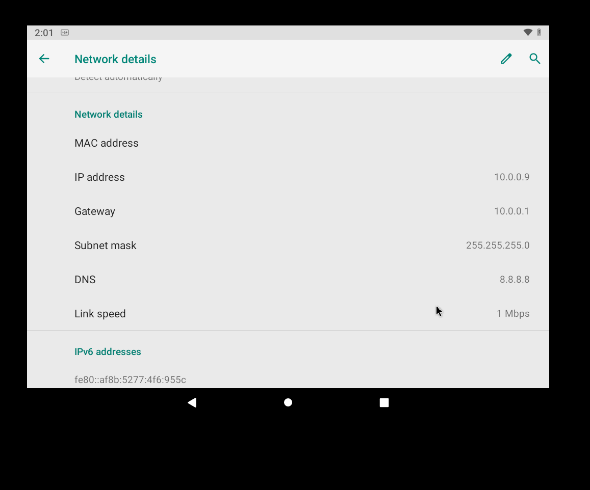
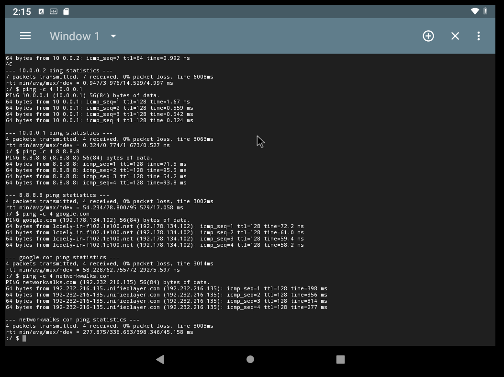

<!--
  REPOSITORY NOTE (author): Upload the project screenshots into an `images/` folder and rename
  them to exactly match the filenames used below (01-vmware-android-vm.png ... 10-android-connectivity-tests.png).
-->

<div align="center">

# 📱 WK1-PMx | Android-x86 9.0 Setup in VMware Workstation

### Installing Android-x86 as a VM, configuring a static IP on the lab network, and testing connectivity with Kali Linux and the internet

**NetworkWalks Cybersecurity Internship · Batch B084J · Week 01 · PMx Extra Project**


</div>

---

## 📑 Table of Contents

- [Project Overview](#-project-overview)
- [Project Demonstration](#-project-demonstration)
- [Objectives](#-objectives)
- [Lab Network Configuration](#-lab-network-configuration)
- [Requirements](#-requirements)
- [Installation and VM Setup](#-installation-and-vm-setup)
- [VMware Network Configuration](#-vmware-network-configuration)
- [Android Static IP Configuration](#-android-static-ip-configuration)
- [Connectivity Testing](#-connectivity-testing)
- [Troubleshooting](#-troubleshooting)
- [Evidence and Screenshots](#-evidence-and-screenshots)
- [Learning Outcomes](#-learning-outcomes)
- [Security and Ethical Use](#-security-and-ethical-use)
- [Acknowledgement](#-acknowledgement)
- [Copyright and Credits](#-copyright-and-credits)
- [Author](#-author)

---

## 📌 Project Overview

This repository documents **WK1-PMx**, an extra Week 1 project from the **NetworkWalks Cybersecurity Program (Batch B084J)**.

The project sets up **Android-x86 9.0** as a virtual machine in **VMware Workstation**, configures its network with a **static IP address** on the lab subnet `10.0.0.0/24`, and tests connectivity with **Kali Linux** and the internet.

> 🔗 **Repository:** [Hypo46/NETWORKWALKS-B084J-WK1-PMx-ANDROID-LAB-SETUP](https://github.com/Hypo46/NETWORKWALKS-B084J-WK1-PMx-ANDROID-LAB-SETUP)

> 📝 **Evidence policy:** This README describes only the configuration and tests listed in the project details. Test outcomes are backed by the screenshots in the [Evidence and Screenshots](#-evidence-and-screenshots) section.

---

## 🎥 Project Demonstration

[Watch the Android-x86 VMware Lab Demo](10-android-connectivity-tests.png)](https://www.linkedin.com/feed/update/urn:li:activity:7522425726763941889/)

**[▶ Watch the full project demonstration on LinkedIn](https://www.linkedin.com/feed/update/urn:li:activity:7522425726763941889/)**

*Click the thumbnail or the link above to open the LinkedIn post with the project video.*

---

## 🎯 Objectives

- ✅ Create an Android-x86 9.0 virtual machine in VMware Workstation.
- ✅ Install and boot Android-x86 inside the VM.
- ✅ Connect the VM to the lab's NAT network.
- ✅ Replace DHCP with a **static IP address** (`10.0.0.9/24`) in Android's network settings.
- ✅ Validate connectivity to Kali Linux, the gateway, public DNS and the internet using `ping`.

---

## 🌐 Lab Network Configuration

| Device | IP Address | Subnet |
|---|---|---|
| Kali Linux | `10.0.0.2` | `/24` |
| Android-x86 9.0 | `10.0.0.9` | `/24` |
| Gateway | `10.0.0.1` | — |
| DNS | `8.8.8.8` | — |

```text
┌──────────────────────────────────────────────────────────────┐
│  Windows Host  ·  VMware Workstation                         │
│                                                              │
│   ┌────────────────────┐      ┌──────────────────────────┐   │
│   │ Kali Linux         │      │  Lab NAT network         │   │
│   │ 10.0.0.2/24        ├─────►│  Subnet   10.0.0.0/24    │───┼──► Internet
│   └────────────────────┘      │  Gateway  10.0.0.1       │   │
│   ┌────────────────────┐      │  DNS      8.8.8.8        │   │
│   │ Android-x86 9.0    ├─────►│                          │   │
│   │ 10.0.0.9/24        │      └──────────────────────────┘   │
│   └────────────────────┘                                     │
└──────────────────────────────────────────────────────────────┘
```

---

## 🧰 Requirements

| Category | Details |
|---|---|
| 🖥️ Hypervisor | VMware Workstation |
| 📱 Guest OS | Android-x86 9.0 (installer ISO) |
| 🐉 Peer VM | Kali Linux (`10.0.0.2`) from the earlier lab modules |
| 🌐 Network | VMware NAT network, subnet `10.0.0.0/24`, gateway `10.0.0.1` |
| 💻 Host resources | Enough RAM, CPU and disk for the VMs *(⚠️ verify exact VM allocation in Figure 1)* |

---

## 🪜 Installation and VM Setup

### 1️⃣ Create the Android-x86 VM in VMware Workstation

Create a new virtual machine in VMware Workstation and attach the Android-x86 9.0 ISO as the installation media. The VM appears in the VMware library and its hardware settings are shown in Figure 1.

<div align="center">



*Figure 1 – `01-vmware-android-vm.png`: The Android-x86 virtual machine in VMware Workstation.*

</div>

> ⚠️ **Fill in from Figure 1:** guest OS type, memory, processors and disk size used for this VM. These values are not stated here because they are not part of the supplied project details.

### 2️⃣ Prepare the Disk and Partition

Boot the VM from the ISO and choose the installation option. The installer needs a partition to install Android-x86 onto, as shown in Figure 2.

<div align="center">



*Figure 2 – `02-android-x86-partition.png`: Partition step of the Android-x86 installer.*

</div>

### 3️⃣ Install and Boot Android-x86

Continue through the installer until Android-x86 is installed, then boot into it.

<div align="center">



*Figure 3 – `03-android-x86-install-boot.png`: Android-x86 installation and first boot stage.*

</div>

<div align="center">



*Figure 4 – `04-android-x86-boot-logo.png`: Android-x86 boot logo while the system starts.*

</div>

### 4️⃣ First Start

After booting, Android shows its welcome (setup) screen, which confirms the VM is running.

<div align="center">


*Figure 5 – `05-android-welcome-screen.png`: Android welcome screen after the first boot.*

</div>

---

## 🔌 VMware Network Configuration

The Android-x86 VM must be on the same VMware NAT network as Kali Linux so both use the `10.0.0.0/24` subnet and gateway `10.0.0.1`.

1. Power off the Android-x86 VM.
2. Open **Virtual Machine Settings → Hardware → Network Adapter**.
3. Select the lab's NAT network (the same custom NAT network used by the Kali Linux VM; subnet `10.0.0.0/24`, gateway `10.0.0.1`).
4. Make sure **Connect at power on** is enabled.
5. Click **OK** and power the VM on.

> 📌 Use the same virtual network selection as the Kali Linux VM. Avoid Bridged mode for this lab so the VMs stay on the isolated lab network.
>
> ⚠️ *Verify:* the exact network name selected for this VM should match the adapter settings visible in Figure 1.

---

## 🔧 Android Static IP Configuration

By default, Android-x86 obtains its address through DHCP (Figure 6). It was changed to a static address:

**Path:** `Settings → Network & Internet → Wi-Fi → VirtWifi → Edit → Advanced options`

| Setting | Value |
|---|---|
| IP settings | Change from **DHCP** to **Static** |
| IP address | `10.0.0.9` |
| Gateway | `10.0.0.1` |
| Network prefix length | `24` |
| DNS 1 | `8.8.8.8` |
| DNS 2 | `8.8.4.4` *(optional)* |

After saving, open **Network Details** to verify the assigned IP address.

<div align="center">



*Figure 6 – `06-android-network-settings-dhcp.png`: VirtWifi network settings with DHCP before the change.*

</div>

<div align="center">



*Figure 7 – `07-android-static-ip-configuration.png`: Static IP configuration entered under Advanced options.*

</div>

<div align="center">



*Figure 8 – `08-android-network-details.png`: Network Details screen used to check the assigned address.*

</div>

<div align="center">



*Figure 9 – `09-android-static-ip-confirmed.png`: Static IP configuration confirmed.*

</div>

---

## ✅ Connectivity Testing

### From the Android terminal

```bash
ping -c 4 10.0.0.2
ping -c 4 10.0.0.1
ping -c 4 8.8.8.8
ping -c 4 google.com
ping -c 4 networkwalks.com
```

### From the Kali Linux terminal

```bash
ping -c 4 10.0.0.9
```

| # | Where | Command | What it checks |
|---|---|---|---|
| 1 | Android | `ping -c 4 10.0.0.2` | Android → Kali Linux connectivity |
| 2 | Android | `ping -c 4 10.0.0.1` | Android → NAT gateway |
| 3 | Android | `ping -c 4 8.8.8.8` | Internet reachability by IP (no DNS needed) |
| 4 | Android | `ping -c 4 google.com` | DNS resolution + internet |
| 5 | Android | `ping -c 4 networkwalks.com` | DNS resolution + internet |
| 6 | Kali | `ping -c 4 10.0.0.9` | Kali Linux → Android connectivity |

**How to read the results:** replies from a target (`bytes from …`, `0% packet loss`) show that the VM can communicate with that target. Test by IP first and then by name: if `8.8.8.8` replies but `google.com` does not, suspect DNS; if neither replies, check the gateway and the VMware adapter. Some hosts and firewalls drop ICMP, so a failed ping to a website does not always mean there is no web access.

<div align="center">



*Figure 10 – `10-android-connectivity-tests.png`: Connectivity tests run from the Android terminal.*

</div>

> ⚠️ **Confirm against Figure 10:** record which of the tests above returned replies and which, if any, did not. Only the results visible in the screenshots should be reported as successful. The Kali → Android ping (row 6) needs its own screenshot if you want it listed as verified.

---

## 🛠️ Troubleshooting

| Problem | Possible cause | What to try |
|---|---|---|
| **Android-x86 boots to a text console** instead of the graphical desktop | Graphics mode not supported by the VM's virtual display | At the GRUB menu, highlight the boot entry, press `e`, add `nomodeset` to the end of the kernel line, then boot (`Ctrl+X` or `F10`). If needed, try `xforcevesa` instead. In VMware, also try turning off 3D acceleration in the VM's display settings |
| **Boot hangs or shows a black screen** | Display or boot option issue | Power off the VM, try the boot options above, and confirm the ISO/installation completed correctly |
| **Static IP not taking effect** | Settings not saved or wrong values | Re-open **VirtWifi → Edit → Advanced options**; confirm IP `10.0.0.9`, gateway `10.0.0.1`, prefix length `24`, DNS `8.8.8.8`; save and check **Network Details** |
| **Still showing a DHCP address** | IP settings left on DHCP | Set **IP settings** to **Static** before entering the address |
| **IP conflict or no replies** | Two devices using the same address | Make sure `10.0.0.9` is not used by any other device (Kali Linux uses `10.0.0.2`) |
| **Cannot reach `10.0.0.1` or Kali Linux** | Wrong VMware network adapter | Open VM Settings → Network Adapter; select the same NAT network as Kali Linux; enable *Connect at power on*; restart the VM |
| **IP pings work but names do not** | DNS problem | Check DNS 1 is `8.8.8.8` (optional DNS 2 `8.8.4.4`) |
| **Ping to a website fails but browsing works** | ICMP blocked by the target | Judge with DNS resolution and a browser test as well as ping |

---

## 📸 Evidence and Screenshots

| Fig. | File | Shows | Section |
|---|---|---|---|
| 1 | `images/01-vmware-android-vm.png` | Android-x86 VM in VMware Workstation | VM setup |
| 2 | `images/02-android-x86-partition.png` | Installer partition step | VM setup |
| 3 | `images/03-android-x86-install-boot.png` | Installation / first boot | VM setup |
| 4 | `images/04-android-x86-boot-logo.png` | Android-x86 boot logo | VM setup |
| 5 | `images/05-android-welcome-screen.png` | Android welcome screen | VM setup |
| 6 | `images/06-android-network-settings-dhcp.png` | Network settings with DHCP | Static IP |
| 7 | `images/07-android-static-ip-configuration.png` | Static IP configuration | Static IP |
| 8 | `images/08-android-network-details.png` | Network Details | Static IP |
| 9 | `images/09-android-static-ip-confirmed.png` | Static IP confirmed | Static IP |
| 10 | `images/10-android-connectivity-tests.png` | Android terminal ping tests | Connectivity |

---

## 🧠 Learning Outcomes

- 🖥️ **VMware virtualization:** creating and managing a guest VM in VMware Workstation.
- 📱 **Android-x86 installation:** installing and booting Android-x86 9.0 on a virtual machine.
- 🔢 **Static IP configuration:** replacing DHCP with a manual IP, gateway, prefix length and DNS in Android's network settings.
- 🌐 **NAT networking:** placing VMs on a shared NAT subnet (`10.0.0.0/24`) with a common gateway.
- 💻 **Linux/Android terminal usage:** running `ping` from Android and Kali Linux terminals.
- ✅ **Connectivity validation:** testing by IP and by hostname to separate network problems from DNS problems.

---

## 🔐 Security and Ethical Use

> ⚠️ **This is an educational lab. Use it only on systems and networks you own or are explicitly authorized to test.**

- Keep the lab VMs on the isolated NAT network.
- Do not use techniques from this lab against third-party systems without written permission.
- This repository is for learning and documentation only.

---

## 🙏 Acknowledgement

Sincere thanks to **Sir and NetworkWalks** for their guidance and for providing a hands-on learning opportunity through the Week 1 PMx project.

---

## © Copyright and Credits

- **Program:** NetworkWalks Cybersecurity Program, Batch B084J
- **Project:** Week 1 – PMx Extra Project (Android-x86 9.0 Setup in VMware Workstation)
- Concept, guidance and training: **NetworkWalks**
- Documentation and lab work: **Rajatava Ghosh**
- Android-x86, VMware Workstation, Kali Linux and other product names are trademarks or projects of their respective owners and are used here for educational documentation only.

---

## 👤 Author

<div align="center">

### **Rajatava Ghosh**

🎓 Cybersecurity Intern – NetworkWalks Cybersecurity Program, Batch B084J

[](https://github.com/RaxingR)
[](https://www.linkedin.com/in/rajatava-ghosh-265aa6316/)
[](https://www.linkedin.com/feed/update/urn:li:activity:7522425726763941889/)

**⭐ Built for learning. Practiced ethically. ⭐**

*Week 1 · PMx Extra Project · NetworkWalks Cybersecurity Internship*

</div># NETWORKWALKS-B084J-WK1-PMx-ANDROID-LAB-SETUP
